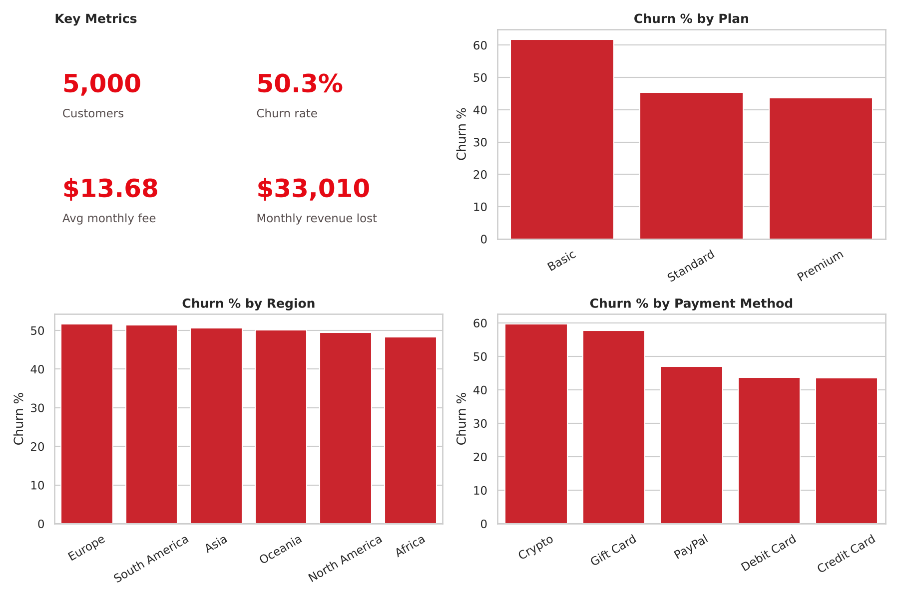
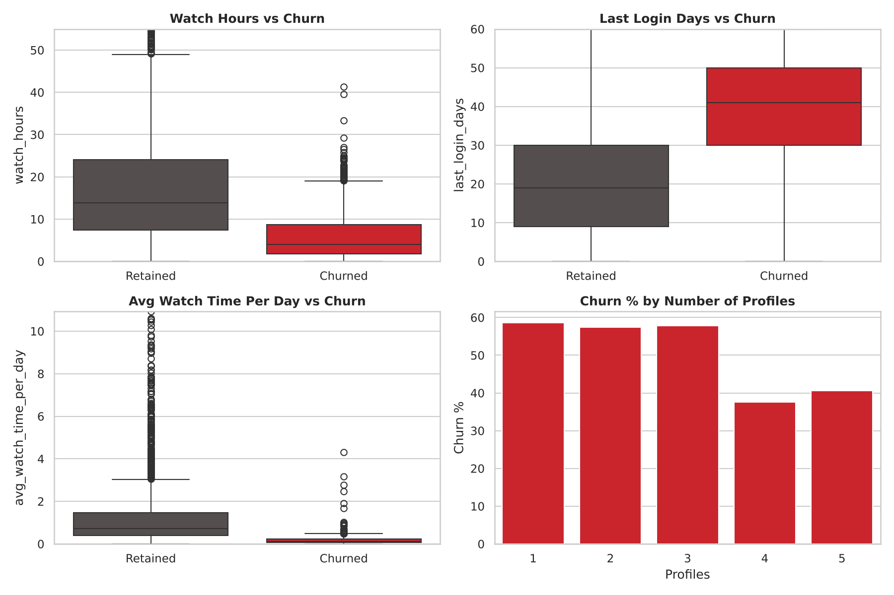
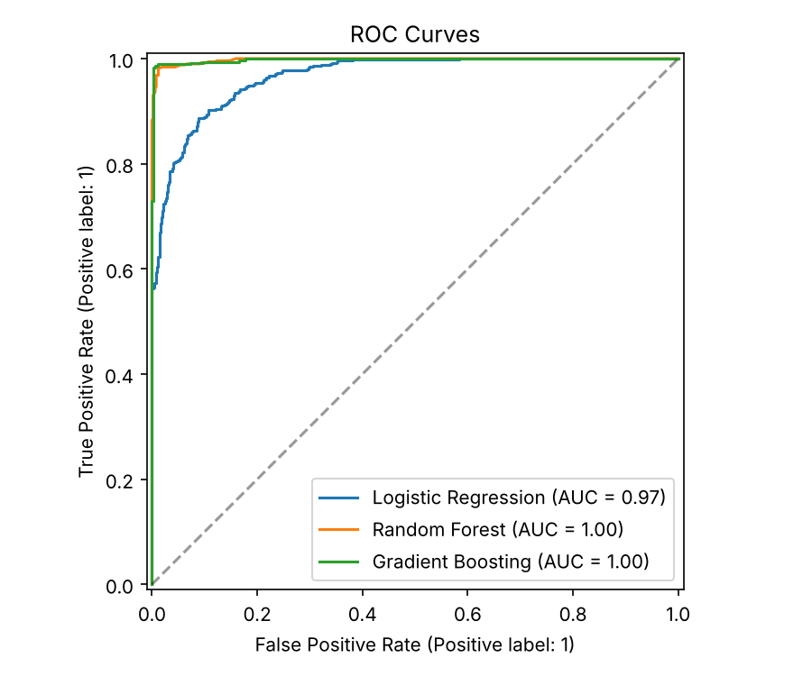

# 🎬 Netflix Customer Churn & Engagement Analytics

> Which subscribers leave, why, and how much revenue is at risk? An analyst-style project using **SQL, Python and a predictive model** to turn churn data into retention actions.

**🔗 Live app:** `<add Streamlit Cloud link>` · **📓 Notebook:** [notebooks/01_eda_and_insights.ipynb](notebooks/01_eda_and_insights.ipynb) · **🧮 SQL:** [sql/churn_analysis.sql](sql/churn_analysis.sql)



<!-- After building the Power BI/Tableau dashboard, save a screenshot as images/09_powerbi_dashboard.png and add it here:  -->

---

## 1. Business problem
Every cancelled subscription is lost recurring revenue. This project answers:
1. **Who** churns most (plan, payment method, engagement, account type)?
2. **How much revenue** is at risk from active but disengaged customers?
3. **Which customers** should the retention team contact first?

## 2. Dataset
5,000 customers × 14 attributes (demographics, plan, viewing behaviour, payment). Target: `churned` (1 = churned). Overall churn rate: **50.3%** (2,515 customers), about **$33K/month** in lost subscription revenue. See [data/README.md](data/README.md) for the data dictionary.

> ⚠️ **Data note:** this is a synthetic/public practice dataset. Churn rates and model scores are illustrative and would differ on real production data.

**Data cleaning:** 10 rows had `avg_watch_time_per_day` above 24 hours (impossible; a division artefact), so values were capped at 24. No missing values or duplicates were found.

## 3. Approach
| Step | What I did | Where |
|---|---|---|
| 1. Clean & validate | Duplicates, missing values, outliers (IQR), impossible values | notebook §1, `src/data.py` |
| 2. SQL analysis | 12 queries: KPIs, segmentation, CTEs, `NTILE`, `RANK` | [`sql/churn_analysis.sql`](sql/churn_analysis.sql) |
| 3. EDA | Segments, engagement and inactivity, correlations, leakage check | notebook, `src/eda.py` |
| 4. Dashboard | KPIs, churn drivers, retention target list | [`dashboard/README.md`](dashboard/README.md) |
| 5. Modeling | 3 classifiers, 5-fold CV, feature-group ablation | `src/train.py` |
| 6. Deployment | FastAPI scoring endpoint + Streamlit app | `src/api.py`, `src/frontend.py` |

## 4. Key insights

| # | Finding | Evidence |
|---|---|---|
| 1 | **Engagement is the dominant churn driver** | Churn falls from **93.6%** (lowest engagement quartile) to **1.0%** (highest) |
| 2 | **Inactivity cliff after 30 days** | 13.4% churn at 0-7 days inactive vs **75.1%** at 30+ days |
| 3 | **Basic plan churns most** | 61.8% vs 45.4% Standard and 43.7% Premium (+18 pts) |
| 4 | **Crypto & Gift Card payers churn more** | 59.7% and 57.8% vs about 43.6% for Credit/Debit cards (~15 pts higher) |
| 5 | **Multi-profile accounts are stickier** | 4-5 profiles: 37.5-40.6% churn vs about 58% for 1-3 profiles |
| 6 | **Premium loses the most revenue** despite the lowest churn rate | $13.3K/month lost vs $9.2K for Basic |
| 7 | **Retention target list** | 337 active at-risk customers worth **$5.2K/month (~$62.7K/year)**; 92% are Premium/Standard |
| 8 | **Region, device, gender and genre are not drivers** | All within about ±3 pts of the 50.3% average |

*At-risk = still subscribed + bottom-half engagement (≤0.29 hrs/day, where 74-94% churn) + inactive 15+ days. Customers matching this profile churn at 85.2% overall.*



## 5. Recommendations
1. **Win-back campaign** for the 337 at-risk customers (SQL Q10 / `at_risk_flag` in the BI export), prioritised by monthly fee, with a **control group** to measure uplift.
2. **Trigger re-engagement at day 15 of inactivity**, before the 30-day cliff where churn jumps to 75%.
3. **Upgrade or bundle offers for Basic-plan users**, the highest-churn plan.
4. **Move Crypto/Gift Card payers to auto-renewing card payment** with a small incentive.
5. **Promote household/multi-profile use** (4-5 profiles churn about 20 pts less).
6. **Prioritise Premium retention by revenue**, not churn rate: it is the largest revenue loss.
7. **Track the share of low-engagement customers weekly** as an early-warning KPI.

## 6. Predictive model
Stratified 80/20 split (4,000 train / 1,000 test), 5-fold cross-validation on train.

| Model | Accuracy | Precision | Recall | F1 | ROC-AUC | CV AUC |
|---|---|---|---|---|---|---|
| Logistic Regression | 0.887 | 0.875 | 0.905 | 0.890 | 0.967 | 0.967 |
| Random Forest | 0.984 | 0.986 | 0.982 | 0.984 | 0.998 | 0.997 |
| **Gradient Boosting** | **0.988** | **0.990** | **0.986** | **0.988** | **0.998** | **0.999** |

**Honest interpretation (leakage check):**
- Scores this high are unusual in real churn problems and point to a clean, synthetic signal.
- `avg_watch_time_per_day` is essentially `watch_hours ÷ days`, so the engagement features overlap: removing one barely changes the score (AUC 0.998 → 0.993).
- Removing the **whole engagement group** (`watch_hours`, `avg_watch_time_per_day`, `last_login_days`) drops ROC-AUC to **0.63**.
- So churn here is driven almost entirely by engagement. The model *supports* the analysis; the business value is in the insights above. On real data I would expect lower scores and would validate on a time-based split.



## 7. Run it yourself
```bash
git clone https://github.com/arpita7819/Netflix-Customer-Churn-Engagement-Analytics.git
cd Netflix-Customer-Churn-Engagement-Analytics
pip install -r requirements.txt

python sql/load_data.py                       # builds netflix.db
sqlite3 netflix.db < sql/churn_analysis.sql   # run the SQL analysis
python -m src.eda                             # EDA charts -> images/
python -m src.train                           # model + metrics -> models/
python -m src.export_for_bi                   # enriched CSV for Power BI
uvicorn src.api:app --reload                  # API  -> http://localhost:8000/docs
streamlit run src/frontend.py                 # App  -> http://localhost:8501
```
**API endpoints:** `GET /health` · `GET /meta` · `POST /predict`

## 8. Repository structure
```
├── data/               # dataset, data dictionary, processed/ (BI export)
├── sql/                # SQL analysis + CSV -> SQLite loader
├── notebooks/          # executed EDA & insights notebook
├── src/                # config, data, eda, train, predict, api, frontend, BI export
├── models/             # trained model + metrics.json
├── images/             # charts and screenshots
├── dashboard/          # Power BI / Tableau build guide (DAX measures)
├── reports/            # written project report
├── docs/               # resume bullets, interview prep
├── requirements.txt
└── LICENSE
```

## 9. Limitations & next steps
- Synthetic data: no real seasonality or customer history.
- No signup/cancel dates, so no cohort retention or survival analysis.
- No cost data for retention offers, so campaign ROI is not estimated.
- Engagement features are measured alongside churn, so the model is descriptive rather than a true early-warning system without time-stamped history.
- Next: A/B test design for the win-back offer, customer lifetime value, time-based validation.

## 10. Author
**Arpita** · [LinkedIn](<add>) · [Email](<add>)
